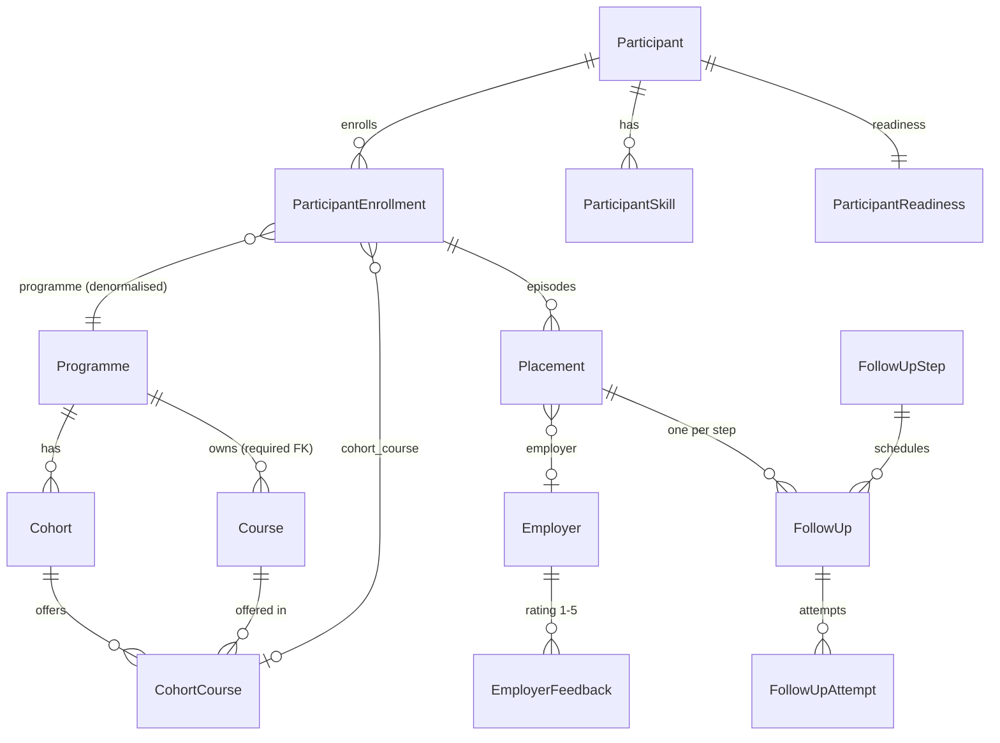
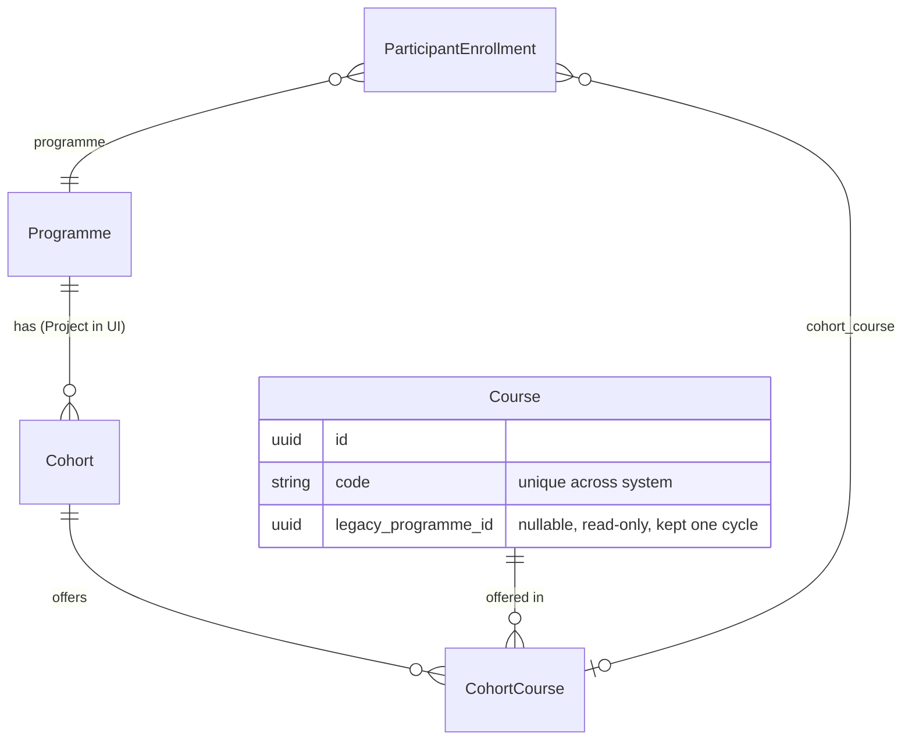
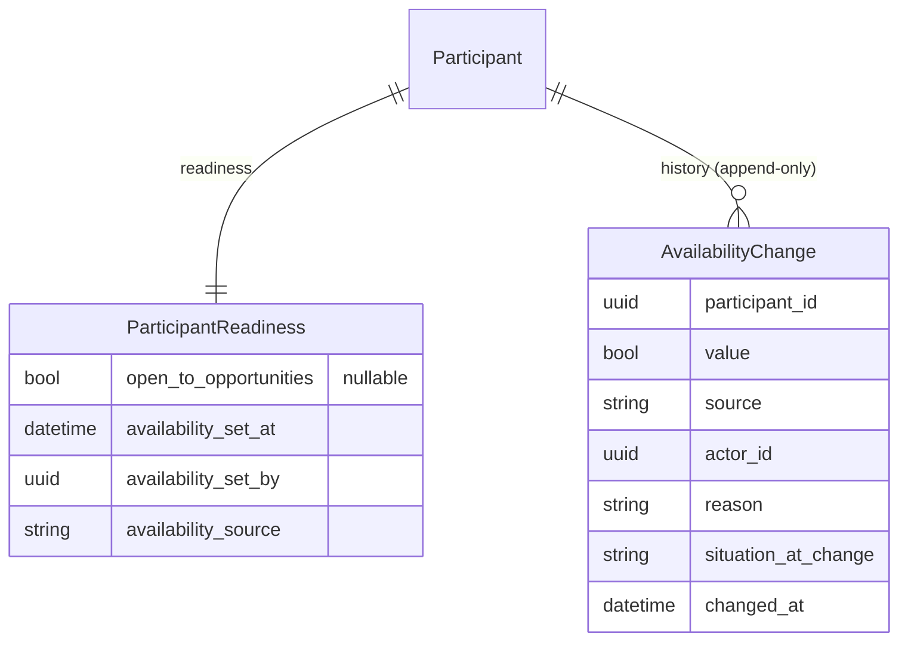
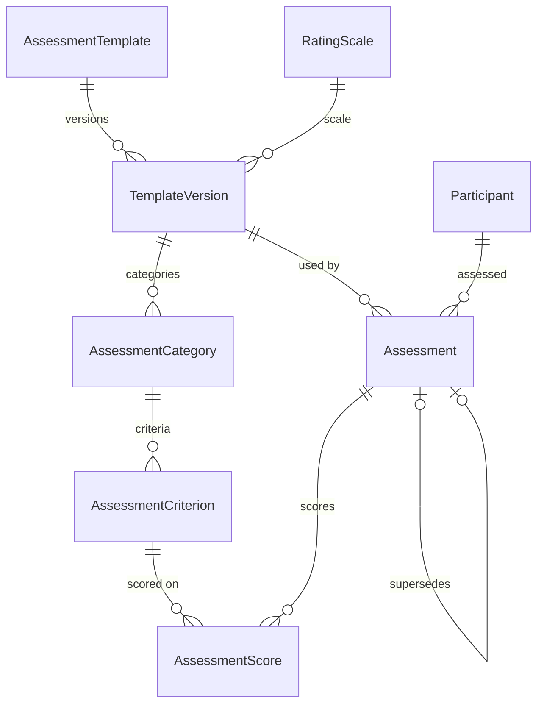
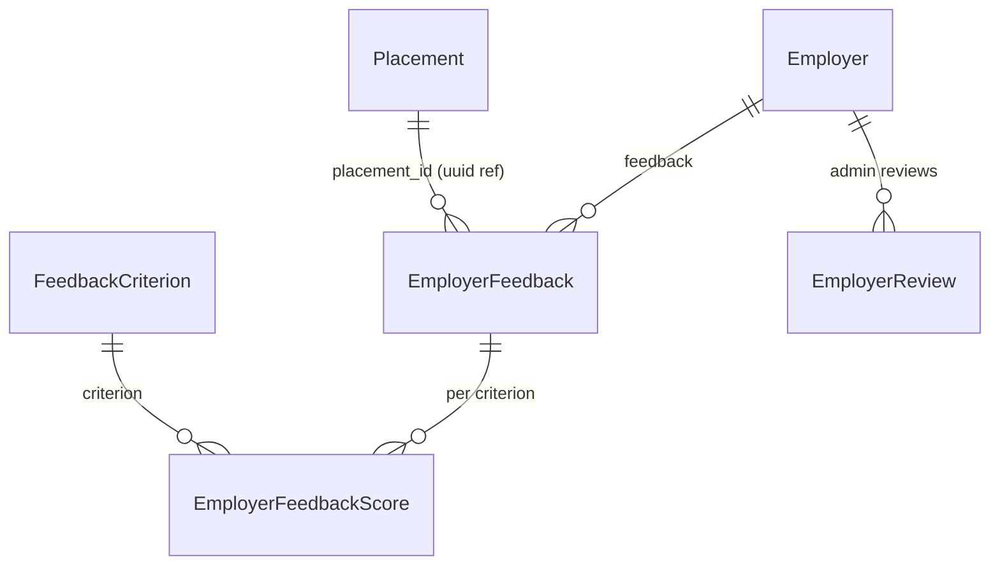
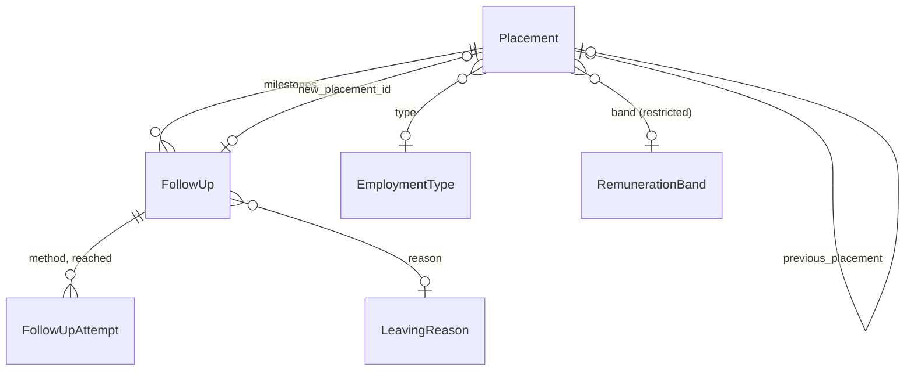
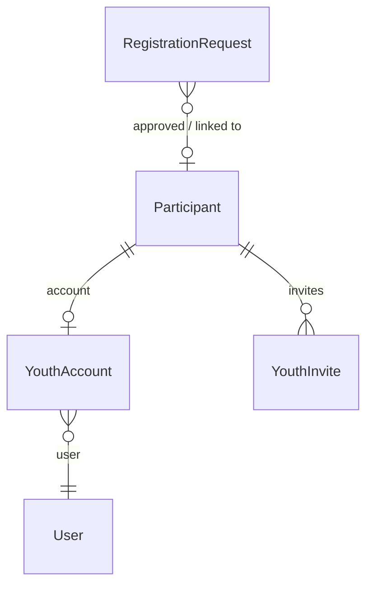

# CAPYEI meeting of 23 November 2026: proposed data model changes

**PI360** · Planning document · 23 Nov 2026 · Status: proposal, **revised after CAP-YEI's answers of 23 Nov 2026** (see §0). No migration has been written or run.

This document is a companion to `docs/capyei-meeting-implementation-plan.md`. Task IDs refer to `docs/capyei-implementation-backlog.md` and decision IDs to `docs/capyei-decision-register.md`.

**Rules every change below follows** (from PROJECT.md and the code):

- Every model's primary key is a UUID.
- "Delete" means archive. Placements, stage events, follow-up attempts and audit rows are append-only.
- A module reads another module's data only through `apps.<module>.services`. The import-linter contracts enforce this.
- Audit (`audit.services.record`) stores keys and field names, never personal values.
- Reference lists are editable data, never code enums, when CAP-YEI may change them.
- All example values here are synthetic.

## 0. Changes after CAP-YEI's answers (23 Nov 2026)

Source: `docs/capyei-answers-impact-assessment.md` §2–§4 (migrations M1–M7). **Where this document and that one differ, that one wins.** §2 and §3 below are kept as written; these rows replace or add to them.

| # in §2 | Was | Now |
|---|---|---|
| 1 | Labels only, no migration | **M1, schema rename** (B1): `Programme` → `Project` with `RenameModel`/`RenameField` (no drop and recreate), every `programme` foreign key renamed to `project`, scope kind `"programme"` → `"project"` by data migration (count scope rows before and after). Audit history is not rewritten. Task NEW-069. |
| 2 | Course owned by Programme | **M2** unchanged in shape: `Course.programme` dropped, `code` unique. Cohort keeps its label plus `intake_year`, `batch_no`, `phase`, `year_of_study` (B4). Enrollment project becomes optional for youth with no project (B4, B39). |
| 4 | Default depends on placement | No placement-derived default. Never-placed youth start Open; placement does not change the flag (B9). |
| 5 | Scale and completion to be decided | One template, 6 competencies, 26 criteria; scale 1–5 (Poor … Excellent); a blank criterion is stored as "not assessed" and excluded; competency and overall scores are averages; each assessment is kept (B13, B15). |
| 6 | Thresholds to be decided | Scale 1–5 (Very Poor … Excellent); negative = 1–2. Review outcomes limited to Monitor and Ignore (B20–B23). Exit feedback gets a **`confidential` boolean per record**, defaulting from an admin setting (A4). |
| 7 | Placement may run alongside another | **M3**: partial unique constraint, at most one running placement per participant (B28). Plus exact salary **and** band (A3), 8 employment types and 8 leaving reasons as editable reference lists (B25), and a self-employment outcome with 7 fields (B27). |
| 8 | Yes / No / Prefer not to say | Yes / No / Not recorded, plus an optional description when Yes; no "Prefer not to say" (B31). Every read is logged (B32). |
| 9 | `RegistrationRequest` needs officer approval | No approval step (B34). A request activates after verification; a possible duplicate sets the review flag with reason "possible duplicate". Rejected requests are kept until an Administrator deletes them (A5). |
| 11 | `Opportunity.projects` only if D-086 (b) | **Not built**: employers and opportunities stay shared (B41). |
| 12 | Project officer role | Same permissions as Placement officer, scoped to projects; import and identifiable export within scope (B37, B40). How export is granted is clarification C-2. |

**New since the answers:** M7, a historical Go Blue disability import (A1), run only after D-090 enablement; a blank stays "Not recorded".

## 1. Existing models that matter (as of 23 Nov 2026)

| Model | App | Relevant fields and facts |
|---|---|---|
| `Programme(Reference)` | configuration | code (unique), name, funder, start, end, status. `Reference` gives a UUID, code, name, name_normalised and active. |
| `Course(Reference)` | configuration | **`programme` FK (PROTECT, required)**, default_sector, level. Unique on `(programme, code)`. |
| `Cohort` | configuration | `programme` FK, `institution` FK, intake_year, batch_no, phase, year_of_study, start, end, status. Unique on `(programme, code)` and on the natural key. |
| `CohortCourse` | configuration | cohort FK, course FK. Unique on `(cohort, course)`. |
| `ReferenceLabel`, `ReferenceAlias` | configuration | Renames add a label row; aliases map source spellings. |
| `Participant` | participants | names, gender (female/male/other/unknown), date_of_birth, origin_county, **status** (active/completed/withdrawn/unknown), consent_*, assigned_officer, merged_into, archived_at. **No disability field. No review status.** |
| `Participant.scope_map` | participants | `programme → enrollments__programme_id`, `cohort → enrollments__cohort_course__cohort_id`, `region → origin_county_id`, `officer → assigned_officer_id` |
| `ParticipantEnrollment` | participants | participant, cohort_course, **programme (denormalised)**, institution, source_enrollment_no (unique per programme when not empty), status, **extra (JSON of source columns)**, exit_reason |
| `ParticipantSkill` | participants | participant, skill, proficiency 1–3. Unique on `(participant, skill)`. Inherits `ProfileFact` (source, entered_by, verified_by, verified_at). |
| `ProfileVerification` | participants | kind, fact_id, status (pending/verified/rejected/needs_reassessment), method, notes, decided_by, decided_at. Unique on `(kind, fact_id)`. |
| `ParticipantReadiness` | participants | One per youth: available_from, work_patterns, interest_sectors, preferred_roles, preferred_counties, willing_to_relocate |
| `Placement` | placements | enrollment FK, employer (nullable), employer_name_source, designation, pathway (wage/self_employment/work_based_learning/further_training), status, start_date, end_date, exit_reason, verification_source, verified_by/on. **Append-only except the REVIEWABLE fields.** No salary and no employment type. |
| `FollowUpStep` | placements | Schedule template: kind (early/tracer), label, offset_days, active. Values are 30 d, 90 d, 6/12/24 m (D-012, D-028). |
| `FollowUp` | placements | placement, step, due_date, status (open/done/unreachable/cancelled), assigned_to, **still_employed (bool)**, evidence_source, response_note, next_action. Unique on `(placement, step)`. |
| `FollowUpAttempt` | placements | Append-only. method (phone/sms/whatsapp/email/visit/other), reached, made_on, note. |
| `Employer` | employers | name, sectors, counties, status, archived_at. **No project link and no scope_map.** |
| `EmployerFeedback` | employers | employer, party (employer/youth), source (call/visit/email/meeting), **rating 1–5**, note, given_on, recorded_by. **No placement link and no criteria.** |
| `Opportunity`, `OpportunityRequirement` | employers | Opportunity has no project link. Requirement: factor (skill/qualification/experience/location/availability/other), is_mandatory. |
| `Referral`, `StageEvent` | referrals | StageEvent is append-only. Stages: draft, submitted, under_review, interview, selected, rejected, withdrawn, no_response, placed, closed. |
| `Role`, `RoleAssignment`, `ScopeAssignment`, `PermissionGrant` | identity | Role.scope_mode is all or assigned. ScopeAssignment holds kind and value (text). |
| `YouthAccount`, `YouthInvite` | portal | One youth account per user, linked one-to-one to a participant. Invites are stored as token hashes with an expiry. |

### 1.1 Current relationships (A, F, D)

## 2. Change summary

| # | Change | Kind | Migration | Requirement | Decision | Task |
|---|---|---|---|---|---|---|
| 1 | Programme → Project wording | Labels only | None | A1 | D-070 | NEW-004 |
| 2 | Course no longer owned by Programme | Schema + data check | Yes (3 steps) | A4 | D-071 | NEW-006 |
| 3 | `participants.verify` permission | Catalogue (code) | None (roles are edited as data) | B | D-072 | NEW-011 |
| 4 | Availability fields + `AvailabilityChange` | New fields + new model | Yes, additive | C | D-073 | NEW-014 |
| 5 | Assessment framework (templates, criteria, scales, assessments, scores) | New models | Yes, additive | D (youth) | D-074, D-075 | NEW-019 |
| 6 | `EmployerFeedback` extended + `FeedbackCriterion` + `EmployerFeedbackScore` + `EmployerReview` | Fields + new models | Yes, additive | D (employer), G | D-077, D-078, D-079 | NEW-026, NEW-028 |
| 7 | Follow-up outcome fields; Placement `previous` link and employment type; remuneration band | Fields | Yes, additive | F | D-080, D-081 | NEW-034, NEW-035 |
| 8 | Participant disability fields | Fields | Yes, additive | H | D-082, D-063, D-090 | NEW-040 |
| 9 | `RegistrationRequest` | New model | Yes, additive | I | D-083 | NEW-044 |
| 10 | Participant review fields | Fields | Yes, additive | J | D-084 | NEW-050 |
| 11 | Optional `Opportunity.projects` | M2M | Yes, additive (only if D-086 is option b) | L | D-086 | NEW-058 |
| 12 | New default role "Project officer" | Data migration (role row) | Yes, data | L | D-085 | NEW-056 |

Every schema change except #2 is **additive**: new nullable fields or new tables. Rolling one back means reverting the migration. No existing column loses data.

## 3. Changes in detail

### 3.1 Projects and courses (A)

**Wording (D-070, option a).**

- No schema change.
- `Programme`, the `programme` FKs, the scope kind value `programme`, the `scope_map` key and the import column `programme_code` all stay as they are.
- The UI, help guides, report titles and spreadsheet headers say "Project".
- The import accepts both `programme_code` and `project_code` headers (NEW-008).
- Existing ScopeAssignment rows, audit keys and saved templates keep working.

**Course independence (D-071, option a).** Three migrations, so each step can be checked and reversed:

1. **Report (no migration).** A read-only management command `course_code_report` lists every course code used in more than one programme, with counts and names. It shows codes and names only, no youth data.
   - If clashes exist, the data steward resolves them before step 3: rename the code and keep the old code as a `ReferenceAlias`, or merge.
2. **Relax.** Make `Course.programme` nullable, drop `uniq_course_code (programme, code)` and add a unique constraint on `code`. This step fails safely if clashes remain.
   - The `programme` value stays filled, so nothing is lost and step 2 can be reverted.
3. **Retire.** After a release cycle, stop reading `Course.programme`: forms, serializers and the import now look up a course by code alone.
   - The column can then be removed, or kept as a read-only `legacy_programme`. The recommendation is to keep it for one pilot cycle, because history (old imports and audit snapshots) refers to it.

Nothing changes for cohorts, cohort courses or enrollments.

- `Cohort.programme` already gives "cohorts belong to projects".
- `ParticipantEnrollment.programme` stays denormalised and keeps feeding scope.
- Every enrollment's `cohort_course` still points to the same rows.

**Import compatibility.**

- `imports/sample.py` builds the Codes sheet as programme/cohort/course, and `find_enrollment(programme_code, enrollment_no)` keys enrollments on programme. Both stay.
- Course lookup inside a row changes from `(programme, code)` to `code`, with `ReferenceAlias` fallback.
- Old files still import.

### 3.2 Availability: "Open for Opportunities" (C)

**Where the field lives.**

- The field goes on `ParticipantReadiness`, the existing one-per-youth record of work preferences. Matching already reads it through `capability_snapshots`.
- Employment situation is **not stored**. It is derived from Placement episodes, so availability and employment can never disagree with each other.

| Field (on `ParticipantReadiness`) | Type | Notes |
|---|---|---|
| `open_to_opportunities` | bool, nullable | null means "not set". Matching treats null by the derived default (D-073). |
| `availability_set_at` | datetime, nullable | |
| `availability_set_by` | FK user, nullable | |
| `availability_source` | choice: youth / staff / system | |

**History (new, append-only model).**

- `AvailabilityChange` records each change: participant, value, source, actor, reason, changed_at, and the employment situation at that moment.
- A separate model is needed because audit stores keys, not values, so "how many youth were open in March" cannot be read from audit.
- Rows are never edited or deleted.

**Derived situation.** This is a service, not a field. `participants`/`placements` compute it per youth:

- `never_placed`: no Placement episode.
- `placed`: any episode with status placed and no end_date.
- `self_employed`: a running episode with pathway self_employment.
- `exited`: episodes exist, all ended.

**Migration:** additive. Existing youth get null, which means "default by situation". No backfill rows are created.

### 3.3 Trainer competency assessment framework (D, youth)

This is one framework for the meeting's "trainer rating" and the IYLDP/YDM template (D-074). Its shape follows `planning/16_YDM_Assessment_Specification.md`.

**Where it lives.**

- A new app `apps/assessments` (CMP for YDM, tasks T-083 to T-085). It gets its own import-linter contract: it may call `participants`, `configuration`, `identity` and `audit` services only.
- This needs an ADR in `planning/04_Technical_Architecture_and_ADRs.md` first (NEW-003).
- Putting it inside `participants` was considered and rejected: that app is already large, and assessments have their own lifecycle and permissions (`ydm.*`).

| Model | Key fields | Notes |
|---|---|---|
| `AssessmentTemplate` | code, name, purpose (trainer/ydm/other), active | Example: "IYLDP round 2" |
| `TemplateVersion` | template, version_no, status (draft/approved/retired), scale FK, scoring_method (equal / weighted), missing_policy (exclude / count_zero / block), min_completion_pct, approved_by, approved_at | Becomes read-only after approval. Same lifecycle idea as rule versions. |
| `RatingScale` | code, min, max, step, labels (JSON: value → label) | No default scale ships (D-052). |
| `AssessmentCategory` | version, code, label, source_label, order, weight (nullable) | source_label keeps the template spelling (e.g. "INTER PERSONNEL SKILLS") |
| `AssessmentCriterion` | category, code, label, source_label, order, weight (nullable) | |
| `Assessment` | participant, enrollment (nullable), cohort (nullable), version, assessor (user), assessed_on, status (draft/submitted/superseded/voided), supersedes (self FK), comments, evidence_note, computed (JSON: category scores, total, completion, method version) | Submitted rows are frozen. A correction is a new row with `supersedes`. |
| `AssessmentScore` | assessment, criterion, value (decimal, nullable), comment | Unique on `(assessment, criterion)` |

**Scope.** Assessments are reached only through the participant: `participants.visible_ids` and `is_visible`. No new `scope_map` is needed. An assessment of an out-of-scope youth returns 404.

**Separation from skills verification.** These tables never touch `ParticipantSkill` or `ProfileVerification`. A skill is verified; a competency is assessed.

**Migration:** additive. There is no historical data. Optional IYLDP import is NEW-025 (D-058).

### 3.4 Employer ratings and exit feedback (D employer, G)

The existing `EmployerFeedback` is extended. No second rating table is created.

| Change | Detail |
|---|---|
| `EmployerFeedback.placement` | FK to `Placement`, nullable (officer-logged general feedback has none). A real FK would cross modules: employers → placements. `Placement` already holds an FK to `Employer`, and the import-linter contract for `apps.employers` forbids importing `apps.placements` (`.importlinter` lines 73–74), so a model FK would create a cycle. Store `placement_id` as a plain UUID column instead; the calling module (`placements` or `casework`) validates it before calling `employers.services`. |
| `EmployerFeedback.kind` | choice: general / followup / exit. Existing rows become general. |
| `EmployerFeedback.channel` | choice: staff / portal / assisted. Existing rows become staff. The existing `source` (call/visit/email/meeting) is kept for staff and assisted rows. |
| `EmployerFeedback.review_status` | choice: counted / excluded. Default counted. Exclusion needs a reason and is audited. Use it for duplicates or abusive content. |
| `EmployerFeedback.rating` | Kept. For criterion-based rows it holds the "overall experience" score, so all existing indicators keep working. |
| `FeedbackCriterion` (new, configuration-style reference) | code, label, order, active. Seeded with the five meeting criteria only after D-077. |
| `EmployerFeedbackScore` (new) | feedback FK, criterion FK, value 1–5. Unique on `(feedback, criterion)`. |
| `EmployerReview` (new) | employer, opened_at, trigger (alert / manual), summary_counts (JSON, counts only), status (open / closed), outcome (no_action / monitor / discussed / referrals_paused), reason, decided_by, decided_at. History is kept; rows are never deleted. |
| Constraint | Unique on `(placement_id, kind='exit')`: one exit feedback per placement. |

**Exit reason.**

- `Placement.exit_reason` already exists and stays the place for the reason.
- The exit form writes the reason to the Placement (through `placements.services.end_episode`) and the rating and comments to `EmployerFeedback`.
- So nothing is duplicated.

**Confidentiality.**

- `employer_portal` services never read `EmployerFeedback`. That stays true, and NEW-061 adds a test for it.
- Comments are free text and are never written to audit.

**Migration:** additive. Existing feedback rows get kind=general, channel=staff, review_status=counted and no criterion rows. Indicators computed from `rating` are unchanged.

### 3.5 Follow-up outcomes and new episodes (F)

**`FollowUp` new fields:**

| Field | Type | Notes |
|---|---|---|
| `outcome` | choice: same_employer / changed_employer / left_employment / self_employed / further_training / not_known | Nullable for old rows. |
| `leaving_reason` | FK to a reference list `LeavingReason` (configuration), nullable | A list, so CAP-YEI can edit it (D-080) |
| `observations` | text | Officer notes. Staff only, never in the portal or audit. |
| `new_placement_id` | UUID, nullable | The episode created by this follow-up, if any |

- `still_employed` is **kept** and filled from `outcome`: true for same, changed and self_employed; false for left; null for not_known.
- `retention_counts`, reports and existing tests are therefore unchanged.
- The follow-up method already exists in `FollowUpAttempt.method` and `reached`. The completing attempt is linked; there is no new field.

**`Placement` new fields:**

| Field | Type | Notes |
|---|---|---|
| `previous_placement` | self FK, nullable | Links the new episode to the one it followed. History is a chain. |
| `employment_type` | FK to reference list `EmploymentType`, nullable | e.g. full-time, part-time, contract, casual, internship (CAP-YEI edits) |
| `remuneration_band` | FK to reference list `RemunerationBand`, nullable | **Only after D-080 and D-090.** Restricted visibility. |

- Job title is the existing `designation`.
- Start date is the existing `start_date`.
- Employer is the existing `employer` or `employer_name_source`.
- New fields are added to `REVIEWABLE` only where officers must be able to correct them (employment_type, remuneration_band). `previous_placement` is set once at creation.

**How a follow-up changes episodes** (service `placements.followups.record_outcome`, one transaction):

| Outcome | Original episode | New episode |
|---|---|---|
| same_employer | unchanged | none |
| changed_employer | `end_episode(end_date = reported leave date or the follow-up date, exit_reason = leaving_reason)`, unless the officer keeps it running (D-081) | `record_manual(pathway=wage, employer/new name, designation, start_date, employment_type, previous_placement=original)`. This generates its own 30 d … 24 m follow-ups. |
| self_employed | ended as above | `record_manual(pathway=self_employment, …)` |
| left_employment | `end_episode(...)` | none. Open follow-ups of the ended episode stay due (tracer questions still apply). |
| further_training | ended or kept (officer choice) | `record_manual(pathway=further_training)` if CAP-YEI counts it (D-080) |

**History preservation.**

- The original Placement row is never overwritten. `Placement.save` already blocks changes outside `REVIEWABLE`, and ending sets only `end_date` and `exit_reason` through the existing service.
- The new job is a new row.

**Migration:** additive. Old follow-ups keep `still_employed` with outcome null. Reports treat null as "not recorded".

### 3.6 Disability (H)

`Participant` new fields. They are added only after D-063 and D-090 allow it; the migration may be prepared earlier, but the fields stay hidden behind the flag `participants.disability`.

| Field | Type | Notes |
|---|---|---|
| `disability` | choice: yes / no / prefer_not_to_say / not_recorded | Default not_recorded. Historical records stay not_recorded. |
| `disability_recorded_at` | datetime, nullable | |
| `disability_source` | choice: staff / youth / import | Same idea as `ProfileFact.source` |

- If D-082 option (b) is chosen, add `disability_types`: an M2M to a reference list.
- **Not stored in `extra`.** Imports may hold a source column in `ParticipantEnrollment.extra`. A mapping from it is a separate, approved step (NEW-042) that writes `disability_source=import`. It is never silent.

**Migration:** additive, default not_recorded, no backfill.

### 3.7 Self-registration (I)

New model `RegistrationRequest`, in `portal`, because it is pre-account self-service.

| Field | Notes |
|---|---|
| given_name, family_name, date_of_birth, gender | As typed. They are **not** copied to Participant until approval. |
| email, phone | Normalised |
| claimed_programme_code, claimed_enrollment_no | Optional: "I was in a CAP-YEI programme" |
| email_verified_at, phone_verified_at | |
| verify_token_hash, verify_expires_at, otp_hash, otp_attempts | Hashes only, same as `YouthInvite.token_hash` |
| status | pending_verification / verified / under_review / approved_new / linked_existing / rejected / expired |
| participant | FK, set on approval or link |
| reviewed_by, reviewed_at, decision_reason | |
| consent_version | Notice version accepted (D-090) |
| created_at, ip_hash | For rate limiting and abuse review. No raw IP is kept. |

**Coexistence.**

- Approval leads to either `participants.create_participant` (new) or an existing participant (link).
- In both cases the existing `portal.services.send_invite`/`activate` creates the account and password. There is still only one path to a `YouthAccount`.
- Invite-only accounts are untouched.
- Rejected and expired requests are kept for the retention period the DPO sets (D-090). No period is assumed.

### 3.8 Review status (J)

`Participant` new fields, separate from `status`:

| Field | Type |
|---|---|
| `review_state` | choice: none / needs_review / reviewed. Default none, so existing youth are not flooded into the queue. |
| `review_reason` | short code: self_registered / self_edit / import_change / officer_flag |
| `review_flagged_at`, `reviewed_at`, `reviewed_by` | |

**Migration:** additive, default none.

### 3.9 Project scoping (L)

- **No schema change is needed for youth, referrals, placements or follow-ups.** `ScopeAssignment(kind="programme")` with `Participant.scope_map["programme"]` already restricts them.
- Referrals, placements and follow-ups are scoped through the participant.
- Optional, only for D-086 option (b): `Opportunity.projects` (M2M to Programme, empty means shared), plus a scope helper in `employers.services`.
- New default role row "Project officer" (`identity/defaults.py` plus a data migration that creates it only if absent). This is configuration data, not business data, and it needs D-085 sign-off.

## 4. Migration order, verification and rollback

| Order | Migration | Verify | Roll back |
|---|---|---|---|
| 1 | Additive fields and tables (3.2, 3.4, 3.5, 3.8) | `manage.py migrate --plan`. Row counts before and after are equal. Existing tests pass. | Reverse the migration; the new columns are dropped |
| 2 | Assessment tables (3.3) | Same | Reverse |
| 3 | Course relax (3.1 step 2) | Clash report empty. Every course keeps its programme value. | Reverse (restores the old constraint, data unchanged) |
| 4 | Disability, registration (3.6, 3.7) | Feature flags are off by default | Reverse |
| 5 | Course retire (3.1 step 3) | One full release after step 3, with no reads of `Course.programme` | Keep the column (`legacy_programme`), so no data loss |

- Every migration gets a migration test (`tests/test_migrations_*`) that runs on a synthetic dataset, built from factories with no real names, and checks counts and links.
- `openapi.yaml` is regenerated and committed in the same change as any serializer change.

## 5. Import and export compatibility

| Area | Effect |
|---|---|
| Participant import template | Header `programme_code` keeps working. `project_code` is accepted as a synonym, and the template shows "Project". No new required columns. Disability is an optional column only after D-082. |
| Placement import (`placement_rows.py`) | Unchanged. New placement fields are optional. |
| Exports (`participants.export_groups`) | New groups: availability, review state. The disability group sits behind `participants.view_disability`. Assessment and rating exports are aggregate-only unless `exports.identifiable` is granted. |
| De-identified exports | Small-cell suppression (`exports.small_cell`) applies to the new disaggregations. |
