# CAPYEI meeting of 23 November 2026: implementation plan

**PI360** · Planning document · 23 Nov 2026 · Status: proposal, **revised after CAP-YEI's answers of 23 Nov 2026** (see §0). No code, migration or data has been changed.

## 0. Changes after CAP-YEI's answers (23 Nov 2026)

CAP-YEI and the DPO answered the decision pack. The full impact is in `docs/capyei-answers-impact-assessment.md`. **Where this plan and that document differ, that document wins.** The sections below are kept as written; this section lists what has changed.

**What is now decided** (`docs/capyei-decision-register.md` §0): D-070 to D-076 and D-078 to D-088, plus D-052, D-054 and D-065. **Still open:** D-077 (B19 criteria; A6 minimum count), D-089 (metrics; see `docs/capyei-metric-definitions.md`) and D-090 (DPO confirmation).

**Superseded in this plan:**

| Where | Was | Now |
|---|---|---|
| §5, §11 Phase 1 | Rename on screens only | Rename **everywhere**: models, tables, fields, API paths and fields, scope kind, frontend, help (B1). Done first. About 8–10 days instead of 2–3. |
| §5 availability | Placed youth default to closed | Employment never changes the flag. Never-placed youth default to Open. Youth marked Closed are left out of suggestions; existing referrals stay and the officer is warned (B9, B12). |
| §5 assessments | Trainers or officers record; minimum completion | Administrators and Placement officers record. 1–5 scale; competency = average of completed criteria; overall = average of the 6; blanks excluded; show "n of 26 completed". No completeness threshold (B15, B16). |
| §5 employer ratings | Thresholds to be set | 1 Very Poor … 5 Excellent. Alert at ≥3 ratings averaging below 3.0, or any single 1. Outcomes Monitor or Ignore. No suspension (B20–B23). |
| §5 placements | Concurrent placements allowed | **One active placement per youth** (B28). Service refusal plus a database constraint. |
| §5 self-registration | Officer approves every sign-up | **No approval** (B34). The account works after e-mail or phone verification (mandatory after the pilot, B33). A possible duplicate sets "Needs Review (possible duplicate)" and officers merge. |
| §5 Project officers | No identifiable export | Project officers import and export identifiable data **within their projects** (B40). How this fits the grant-only `exports.identifiable` permission is clarification C-2. |
| §5 disability | Yes / No / Prefer not to say | Yes / No, with an optional description if Yes. No "Prefer not to say". "Not recorded" stays for blanks. All access is logged (B31, B32). |
| §5 exit feedback | Never shown to employer | Confidentiality is stored **per record**; the admin default is ON; a change applies to new submissions only (A4). |
| §5 employer evidence | Separate column | Employer quality shows as a **warning**, never overriding mandatory requirements. Inactive employers excluded (B24; C-4). |
| §11 phases | Phases 0–5 | Replaced by the revised phases in the impact assessment §5. |
| §15 AC-A1 | API unchanged | No "Programme" anywhere in the UI, API, database names or help; imports accept both header names. |
| §15 AC-D2 | No total below minimum completion | Totals are shown with "n of 26 criteria completed". |
| §15 AC-D3 | Employer averages above the minimum count | Employer aggregates are allowed (A6), but stay off until the minimum count is set. |
| §15 AC-G1 | Never shown to the employer | Shown or hidden per the confidentiality stored on each record. |
| §15 AC-I1 | Officer approval prevents duplicates | Possible duplicates are flagged for review and merged by an officer; none are created silently without the flag. |
| §17 | All D-070 to D-090 open | See "What is now decided" above. |
| §18 | Sequence by decision | Follow the revised phases in the impact assessment §5. |

**Not changed by the answers:** mandatory and preferred employer requirements stay separate from the B19 rating criteria; deny-by-default scope and 404 for out-of-scope records; append-only history and audit; no real youth data in development, tests or documents. New sensitive features are built on synthetic data and switched on for real youth only after D-090.

Companion documents:

- `docs/capyei-implementation-backlog.md`: tasks PI360-NEW-001 to 068.
- `docs/capyei-data-model-changes.md`: schema, migrations, ER diagrams.
- `docs/capyei-decision-register.md`: decisions D-070 to D-090, all open.

Traceability convention: **Requirement (A–M) → existing component → gap → proposal → acceptance criterion (AC-x) → task (NEW-nnn) → decision (D-nnn).**

---

## 1. Executive summary

PI360 already covers most of what the meeting asked for in its foundations:

- programme scope and deny-by-default authorization;
- append-only placement episodes with 30-day to 24-month follow-ups;
- a per-skill verification record;
- employer feedback with an "insufficient evidence" rule;
- a rules engine with a draft → approved lifecycle;
- a youth portal and an employer portal.

The meeting's requirements are therefore mostly **extensions**, not new systems.

**Gaps that need new work:**

- trainer competency assessments (no model yet);
- criterion-based employer ratings and exit feedback;
- an "Open for Opportunities" flag that matching respects;
- follow-up outcomes that start a new episode on a job change;
- a disability field;
- self-registration;
- a review flag;
- courses that are not owned by one programme.

**Two items carry most of the risk:**

1. **Project isolation (L).** The scope mechanism exists and works for youth. The risk is in the edges: exports, imports, orphan youth, and globally shared employers and opportunities. A full cross-project test suite (NEW-061) is the main safeguard.
2. **Sensitive data (H, I, D, G).** Disability, self-registration, trainer comments and exit feedback all need DPO approval (D-090) before production. The plan prepares them behind flags and does not switch them on.

**Effort:** 68 tasks, about 156 developer-days (±20 %). Trainer assessments with matching (Phase 4) is the largest block and is blocked on the scale, weight and template decisions.

**Decisions needed first:** D-070 (wording), D-072 (bulk verify), D-073 (availability), D-085 (Project officer) and D-090 (DPO addendum). Those unlock Phases 1 and 2.

## 2. Requirements

These are summarised from the meeting brief. The wording is a paraphrase; the original is in the meeting notes.

| ID | Requirement |
|---|---|
| A | Say "Project" instead of "Programme". Cohorts belong to projects. Courses are independent of projects and can be reused. Fix Go Blue setup. |
| B | Verify many skills at once, recording who, when and what. |
| C | "Open for Opportunities" toggle. Placed youth are excluded from matching unless they opt in. |
| D | Trainer ratings of youth competencies (IYLDP categories). Youth rate employers on set criteria. |
| E | Matching uses competencies and employer feedback, without overriding mandatory requirements. |
| F | Follow-ups record outcome, reason for leaving, new employer. A job change creates a new episode, not an overwrite. |
| G | Exit feedback when a youth leaves an employer. |
| H | Disability field after Gender ("Jeddah" placement to confirm). |
| I | Youth self-registration, without duplicates. |
| J | A "needs review" flag for records changed by youth or imports. |
| K | Portal: placement history, job-change self-report, exit feedback, opportunities. |
| L | Project officers see only their project's youth. |
| M | Reports: project scorecards, retention, changed employer, self-employment, conversion, employer responsiveness. |

## 3. Existing assessment

| Area | What exists (evidence) |
|---|---|
| Projects | `configuration.Programme`, `Cohort.programme`, `ParticipantEnrollment.programme` (denormalised); scope kind `programme` in `Participant.scope_map`. |
| Courses | `configuration.Course` with **required** `programme` FK; unique on `(programme, code)`; `CohortCourse` link exists. |
| Skills verification | `ProfileVerification` (pending/verified/rejected/needs_reassessment), per fact, with decided_by/at; per-entry UI in `skills-dialog.tsx`. |
| Readiness | `ParticipantReadiness` (available_from, preferences); read by `intelligence.capability_snapshots`. |
| Matching | `intelligence.suggest_youth`; `pi360_rules` factors B-QUAL…B-COND; mandatory checks give eligible / eligible_with_unknowns / not_eligible; preferred weights undecided. |
| Assessments | `planning/16_YDM_Assessment_Specification.md` (6 categories, 26 criteria); `ydm.*` permissions; Assessor role inactive until D-024. No model. |
| Employer feedback | `EmployerFeedback` (party, source, single rating 1–5, note); `intelligence.employer_evidence` gives "insufficient" below `employer.min_referrals` (D-027). |
| Placements | Append-only episodes; `record_manual`, `end_episode`, `running_with_employer` (concurrent allowed with warning). |
| Follow-ups | `FollowUpStep` (30 d, 90 d, 6/12/24 m), `FollowUp.still_employed`, `FollowUpAttempt` (method, reached). |
| Disability | None. `reports.py:823` states it is not collected; listed in `NOT_CAPTURED`. |
| Registration | Invite-only: `YouthInvite` (hashed token) → `activate`. |
| Review flag | None; `Participant.status` is the lifecycle status. |
| Portals | Youth: dashboard, my-details, my-opportunities (referrals), my-placement, journey. Employer: invite-only accounts; never reads `EmployerFeedback`. |
| Scope | Role scope all/assigned; ScopeAssignment programme/cohort/region/officer; deny when none; out of scope returns 404. Employers and opportunities are global. |
| Reporting | `METRICS` (with approved flag), `NOT_CAPTURED`; reports programme_scorecard, placement_outcomes, equity_and_reach, retention, employer_pipeline. |
| Older design | `docs/learner-support-design.md`: design only, proposes 1w/30/60/90/6m check-ins (conflicts with D-012) and says there is no employer login (outdated). **Superseded by this plan for overlapping parts.** |

## 4. Gap analysis

Classes: **1** Already met · **2** Met with configuration · **3** Small extension · **4** Significant extension · **5** New capability · **6** Needs a decision first.

| Req | Class | Evidence | Gap | Risk | Complexity | Migration |
|---|---|---|---|---|---|---|
| A wording | 2/6 | ~30 frontend files say "Programme" | Labels only | Low (confusion if API renamed) | Medium | No |
| A cohorts in projects | 1 | `Cohort.programme` FK | None | — | — | No |
| A courses independent | 4/6 | `Course.programme` required; unique `(programme, code)` | Make FK optional; global code | Medium (code clashes) | Large | Yes |
| A Go Blue | 6 | Not reproduced; cause unknown | Investigate | Low | Small | No |
| B bulk verify | 3 | Per-entry `ProfileVerification` | Batch service + UI | Low | Medium | Data (permission) |
| C open toggle | 4/6 | `ParticipantReadiness`; `suggest_youth` does not exclude placed youth | Field + history + matching filter | Medium (wrong default hides youth) | Medium | Yes |
| D trainer ratings | 5/6 | Spec and permissions only | New module | High (scale, weights undecided) | Very Large | Yes |
| D employer ratings | 4/6 | Single rating; no criteria, no placement link | Criteria + scores + summary | Medium (small numbers, fairness) | Medium | Yes |
| E matching | 4/6 | Rules engine, lifecycle | B-COMP factor, ranking column | High (mis-ranking) | Medium | No (rule version is data) |
| F follow-ups | 4 | `still_employed` only | Outcome fields + `record_outcome` | Medium (overwrite risk) | Large | Yes |
| G exit feedback | 3/6 | `exit_reason` on Placement; feedback model | Form + kind=exit | Medium (confidentiality) | Medium | Yes |
| H disability | 5/6 | None | Field + permission + reports | High (sensitive data) | Medium | Yes |
| I self-registration | 5/6 | Invite-only | Request → review → invite | High (duplicates, abuse) | Very Large | Yes |
| J review flag | 3 | None | Fields + triggers | Low | Medium | Yes |
| K portal | 3/4 | Portal pages exist | New sections | Medium (authz) | Medium | No |
| L isolation | 2/3 | ScopeAssignment programme | Role, edge cases, tests | **High** (data leak) | Medium | Data (role) |
| M reporting | 3/4 | Reports exist | New measures | Medium (definitions) | Large | No |

## 5. Proposed behaviour

- **Projects (A).** Users see "Project". A project officer assigned to Project X sees X's youth. Courses are picked from one list; a cohort lists the courses it offers.
- **Bulk verification (B).** The officer filters pending skills, selects up to 200 and chooses "Verified" or "Needs reassessment" with a method. One record per skill is kept with the officer, date and method.
- **Availability (C).** Each youth has "Open for opportunities: Yes/No/Not set". When not set, unplaced youth count as open and placed youth as not open. Matching lists only open youth. Staff can override with a reason. Every change is kept.
- **Trainer assessment (D1).** A trainer scores a youth against an approved template version. Submitted assessments are frozen; corrections supersede. No total is shown below the minimum completion.
- **Employer ratings (D2).** Youth rate employers on approved criteria (1–5), through the portal or with an officer. Averages show only above the minimum count. Administrators review flagged employers; nothing is suspended automatically.
- **Matching (E).** Mandatory requirements decide eligibility. Competency is a preferred factor once approved. Employer evidence is shown beside matches, not mixed into the youth's score.
- **Follow-ups (F).** The officer records an outcome. "Changed employer" ends the old episode and creates a new one linked to it, with its own follow-up schedule.
- **Exit feedback (G).** When an episode ends, reason goes on the placement; rating and comments go to staff-only feedback.
- **Disability (H).** Optional question after Gender, visible only with a permission, reported with suppression.
- **Self-registration (I).** A youth submits a request and verifies a contact. An officer links it to an existing participant or creates a new one, then the usual invite follows.
- **Review flag (J).** Records changed by youth or imports get "Needs review"; officers mark them reviewed in bulk. Nothing is blocked.
- **Portal (K).** Youth see their placement history, report a job change, and give exit feedback.
- **Reporting (M).** New measures are labelled "definition pending" until approved.

## 6. Architecture impact

- **No new framework, UI kit or layer.** Django/DRF, React/Metronic 9 and the existing components only.
- **New module:** `apps/assessments` (NEW-003 ADR; import-linter contract).
- **Cross-module ids** without FKs: `EmployerFeedback.placement_id`, `FollowUp.new_placement_id`, to keep the employers ↔ placements contracts acyclic.
- **Services first:** all logic in `services.py`; views stay thin.
- **Feature flags:** `participants.disability`, `portal.self_registration`, `assessments.enabled`, `employers.criteria_ratings`. All off by default.
- **Settings registry:** `matching.include_placed_default`, `availability.stale_days`, `employer.min_feedback`, `employer.alert_rating`, `employer.alert_count`, `verification.bulk_limit`. Values come from decisions; empty means feature inactive.
- **Jobs:** a nightly employer-alert check using the existing job pattern.

## 7. Data model

See `docs/capyei-data-model-changes.md`. Summary:

- **Fields:** `ParticipantReadiness` (availability), `Participant` (disability, review), `FollowUp` (outcome), `Placement` (previous, type, band), `EmployerFeedback` (placement_id, kind, channel, review_status).
- **New models:** `AvailabilityChange`, assessments (7 models), `FeedbackCriterion`, `EmployerFeedbackScore`, `EmployerReview`, `RegistrationRequest`, reference lists `LeavingReason`, `EmploymentType`, `RemunerationBand`.
- **Only non-additive change:** `Course.programme` becomes optional and course code unique (three-step migration).

## 8. Backend

| Area | Plan |
|---|---|
| Apps | Extend participants, placements, employers, intelligence, portal, reporting, identity. New `assessments`. |
| Models / migrations | Data model doc §3–4. Additive except courses. |
| Services | `bulk_verify`, `set_availability`, `situation_for`, `record_outcome`, `record_exit_feedback`, assessment `submit`/`supersede`/`score`, `employer_evidence` (criteria block), registration `submit`/`verify`/`decide`, `flag_for_review`/`mark_reviewed`. |
| Endpoints | Bulk verify; availability; assessments CRUD + submit; feedback criteria; employer reviews; follow-up outcome; exit feedback; registration (public, flagged); review queue; reports. |
| Serializers | Unique names; sensitive fields omitted without permission. |
| Permissions | New: `participants.verify`, `participants.view_disability`, `assessments.view`, `assessments.capture`, `assessments.manage`, `employers.review`, `registrations.review`. |
| Scope | All youth-linked data through `participants.visible_ids`; out of scope returns 404. |
| Audit | One event per changed record, keys and field names only; batch id for bulk. |
| Validation and errors | 400 with field errors; 404 for out of scope; 409 for duplicates (exit feedback, concurrent episode warnings returned as warnings, not errors). |

## 9. Frontend

| Area | Plan |
|---|---|
| Pages | Verification queue; assessment templates; cohort assessment grid; employer reviews; registration queue; public registration; portal history/exit. |
| Components | Reuse data-table, BulkBar, dialogs, form fields, badges from Metronic 9 per `UI-STANDARDS.md`. |
| Forms | Disability after Gender; follow-up outcome with conditional fields; exit form; availability toggle with reason. |
| Tables and bulk | Select-all-on-page, confirm dialog with count. |
| Filters | Project, cohort, course, review state, availability. |
| Dashboard | New tiles (NEW-063). |
| Navigation | Sidebar entries in `layout-1.config.tsx` shown by permission. |
| Portal | New sections in `my-placement`, `my-details`. |
| States | Loading, empty, error and "insufficient evidence" states on every new screen. |
| Accessibility | WCAG 2.1 AA; text labels with badges; keyboard grid. |
| Mobile | All portal and follow-up screens usable at 375 px. |

## 10. Security and privacy

- **Least privilege:** new permissions are not granted to roles automatically, except `participants.verify` to roles that already verify.
- **Sensitive data:** disability, remuneration, trainer comments and exit comments are restricted fields, never in audit values, never in the employer portal.
- **Public endpoints (I):** rate-limited, generic responses, hashed tokens, no raw IP, flag off by default.
- **Exports:** filtered by scope, small-cell suppression for disaggregations.
- **DPO:** D-090 must approve before production enablement of H, I, D1 comments, G and remuneration. Retention periods, lawful bases and consent policies are **not** changed by this plan.
- **Synthetic data only** in fixtures, tests, screenshots and documentation.

## 11. Phases

### Phase 0: Decisions and foundations (week 1–2)
- **Objective:** get decisions and safe test data in place.
- **Scope / tasks:** NEW-001, 002, 003, 009.
- **Backend:** seed command. **Frontend:** none. **DB:** none.
- **Dependencies:** CAP-YEI availability.
- **Acceptance criteria:** D-070, 072, 073, 085 answered; synthetic seed works.
- **Tests:** seed tests.
- **Risks:** decisions delayed.
- **Definition of Done:** register updated; ADR merged.

### Phase 1: Wording, isolation, review, bulk verification (weeks 3–5)
- **Objective:** safe project-scoped use with less officer workload.
- **Tasks:** NEW-004, 010–013, 050–051, 056, 057, 059–061.
- **Backend:** bulk service, permission, review fields, role.
- **Frontend:** labels, verification queue, review UI.
- **DB:** review fields, permission and role data migrations.
- **Dependencies:** Phase 0.
- **Acceptance criteria:** AC-A1, AC-B1, AC-J1, AC-L1–L3.
- **Tests:** scenarios 1, 2, 8, 10.
- **Risks:** missing an endpoint in the isolation suite.
- **Definition of Done:** help guides updated; CI green.

### Phase 2: Availability, follow-ups, feedback (weeks 6–9)
- **Objective:** correct matching pool and full employment history.
- **Tasks:** NEW-014–018, 034–039, 026–029.
- **DB:** availability, follow-up, placement and feedback migrations.
- **Dependencies:** D-073, D-077, D-079, D-080, D-081.
- **Acceptance criteria:** AC-C1, AC-C2, AC-F1, AC-F2, AC-G1, AC-D3.
- **Tests:** scenarios 4, 5, 6.
- **Risks:** wrong availability default hides youth.
- **Definition of Done:** as above.

### Phase 3: Courses, self-registration, portal (weeks 10–13)
- **Tasks:** NEW-005–008, 044–049, 052, 053, 055, 040–043 (enablement waits for D-090).
- **Dependencies:** D-071, D-082, D-083, D-090.
- **Acceptance criteria:** AC-A2, AC-I1, AC-I2, AC-K1, AC-H1.
- **Tests:** scenarios 7, 9; migration tests.
- **Risks:** course code clashes; registration abuse.

### Phase 4: Trainer assessments and matching (weeks 14–18)
- **Tasks:** NEW-019–025, 030–033, 054.
- **Dependencies:** D-074, D-075, D-076, D-052–D-058, D-024, D-087, D-088.
- **Acceptance criteria:** AC-D1, AC-D2, AC-E1.
- **Tests:** scenario 3; rules regression.
- **Risks:** scale and weights undecided; this phase may slip without affecting the rest.

### Phase 5: Reporting, hardening, UAT (weeks 19–21)
- **Tasks:** NEW-062–068.
- **Acceptance criteria:** AC-M1, all 10 scenarios pass.
- **Risks:** metric definitions not approved.
- **Definition of Done:** CAP-YEI UAT sign-off.

## 12. Dependencies

```mermaid
graph TD
    N001[001 Decisions/DPIA] --> N004[004 Wording]
    N001 --> N010[010 Bulk verify]
    N001 --> N014[014 Availability]
    N001 --> N056[056 Project officer]
    N002[002 Fixtures] --> N061[061 Authz suite]
    N003[003 ADR] --> N019[019 Assessment models]
    N003 --> N026[026 Feedback criteria]
    N011[011 Verify permission] --> N010
    N010 --> N012[012 Endpoint] --> N013[013 Queue UI]
    N014 --> N016[016 Matching pool]
    N015[015 Situation] --> N016
    N016 --> N018[018 Referral warning]
    N014 --> N017[017 Toggle UI]
    N034[034 Follow-up fields] --> N036[036 record_outcome]
    N035[035 Placement fields] --> N036
    N036 --> N037[037 Retention] --> N064[064 Reports]
    N036 --> N038[038 Follow-up UI]
    N036 --> N039[039 Exit feedback]
    N026 --> N039
    N026 --> N027[027 Summary] --> N028[028 Alerts]
    N027 --> N029[029 Rating UI]
    N027 --> N033[033 Ranking column]
    N019 --> N020[020 Scoring] --> N022[022 Capture UI]
    N024[024 Assessor role] --> N022
    N020 --> N030[030 B-COMP] --> N032[032 Draft rule]
    N020 --> N031[031 Snapshot] --> N032
    N006[006 Course migration] --> N007[007 Admin UI]
    N006 --> N008[008 Import]
    N044[044 Registration model] --> N045[045 Endpoints] --> N049[049 Frontend]
    N044 --> N046[046 Review queue] --> N047[047 Activation]
    N040[040 Disability] --> N041[041 Forms]
    N040 --> N043[043 Reports]
    N050[050 Review state] --> N051[051 Review UI]
    N050 --> N052[052 Portal history]
    N036 --> N052
    N056 --> N060[060 Import/export scope]
    N056 --> N061
    N062[062 Metric defs] --> N063[063 Tiles]
    N062 --> N064
```

## 13. Work breakdown structure

See the backlog for task detail. Grouped:

1. **X Setup** (4.5 d): 001–003
2. **A Projects and courses** (14.5 d): 004–009
3. **B Bulk verification** (7.5 d): 010–013
4. **C Availability** (8.5 d): 014–018
5. **D1 Trainer assessment** (19.5 d): 019–025
6. **D2 Employer ratings** (10.5 d): 026–029
7. **E Matching** (9 d): 030–033
8. **F Follow-ups** (11.5 d): 034–038
9. **G Exit feedback** (2.5 d): 039
10. **H Disability** (7.5 d): 040–043
11. **I Self-registration** (16 d): 044–049
12. **J Review flag** (4.5 d): 050–051
13. **K Portal** (9.5 d): 052–055
14. **L Isolation** (12.5 d): 056–061
15. **M Reporting** (8 d): 062–064
16. **Close** (10 d): 065–068

## 14. Testing

| Type | What |
|---|---|
| Unit | Scoring, situation, retention, outcome transitions, summary thresholds. |
| Integration | Services across modules through their public services. |
| Migration | Each migration forward and back on synthetic data; row counts equal. |
| API | Every new endpoint: 200/400/403/404. |
| Permission matrix | Every route in `test_authz_matrix.py`. |
| Project isolation | Two projects, shared youth, every youth-linked endpoint (NEW-061). |
| Matching | Pool policy, mandatory-before-preferred, unknown not a fail. |
| Rules regression | Draft vs active rule version comparison (NEW-032). |
| Portal authz | Youth A cannot read youth B; no trainer comments or internal notes. |
| Bulk | Limit, rollback, per-item audit. |
| Frontend components | Forms, dialogs, tables, conditional fields. |
| Playwright | The 10 scenarios (NEW-067). |
| Accessibility | axe on all new screens; keyboard path for grids and bulk. |
| Performance | Bulk 200 items < 5 s; directory with availability filter at 10k synthetic youth < 1 s server time. |
| Data migration | Course relax with a deliberate clash; disability default. |
| Regression | Full existing suite, retention and matching tests unchanged. |

**The 10 scenarios** (each automated, synthetic data):

| # | Scenario | Test | Task |
|---|---|---|---|
| 1 | Project Officer A cannot access Project B youth through the UI or the API. | API 404 for every youth-linked endpoint; UI list excludes them. | NEW-061, 067 |
| 2 | A youth in two projects is visible to both officers. | Both officers get 200. | NEW-061 |
| 3 | A mandatory qualification mismatch is not made eligible by a high trainer rating. | Rule evaluation stays not_eligible. | NEW-030 |
| 4 | A placed youth with Open for Opportunities disabled is excluded from recommendations. | `suggest_youth` excludes. | NEW-016 |
| 5 | Changing employers creates a new episode without overwriting. | Original row unchanged; new row linked. | NEW-036 |
| 6 | An employer with insufficient feedback gets no unsupported overall rating. | Summary says insufficient, no average. | NEW-027 |
| 7 | A youth cannot access another youth's trainer assessment or internal notes. | Portal 404; fields absent. | NEW-024, 052, 061 |
| 8 | Bulk verification records the officer, date and changes for every skill. | One verification + audit per skill. | NEW-010 |
| 9 | Self-registration does not duplicate existing participants. | Link path; participant count unchanged. | NEW-046 |
| 10 | Project-level exports contain only authorized records. | Export ids ⊆ visible ids. | NEW-060 |

## 15. Acceptance criteria

| ID | Criterion |
|---|---|
| AC-A1 | No user-facing "Programme" text; API unchanged. |
| AC-A2 | A course can be offered in cohorts of two projects; history intact. |
| AC-B1 | Bulk verification of up to 200 skills, each with officer, date, method, audit. |
| AC-C1 | Effective availability follows D-073 defaults; every change kept. |
| AC-C2 | Matching excludes youth who are not open (scenario 4). |
| AC-D1 | Submitted assessments are immutable; corrections supersede. |
| AC-D2 | No total below minimum completion. |
| AC-D3 | Employer averages only above the minimum count (scenario 6). |
| AC-E1 | Mandatory failures are never overridden (scenario 3). |
| AC-F1 | Job change creates a linked new episode (scenario 5). |
| AC-F2 | Retention reported as same employer and any work. |
| AC-G1 | One exit feedback per episode; never shown to the employer. |
| AC-H1 | Disability visible only with permission; suppressed in reports. |
| AC-I1 | No duplicate participants from self-registration (scenario 9). |
| AC-I2 | Public endpoints reveal nothing about existing people. |
| AC-J1 | Review flag never blocks other actions. |
| AC-K1 | Youth see only their own data (scenario 7). |
| AC-L1 | Out-of-scope youth return 404 (scenario 1). |
| AC-L2 | Shared youth visible to both projects (scenario 2). |
| AC-L3 | Exports and imports respect scope (scenario 10). |
| AC-M1 | Each new metric shows its definition and approval status. |

## 16. Risks

| Risk | Likelihood | Impact | Mitigation |
|---|---|---|---|
| Cross-project data leak via an unscoped endpoint | Medium | High | NEW-061 suite over every endpoint; 404 default. |
| Decisions delayed (D-074, D-076, D-090) | High | Medium | Phases ordered so blocked work comes last; flags keep prepared work off. |
| Course code clashes block migration | Medium | Medium | Read-only clash report first; aliases. |
| Wrong availability default hides youth | Medium | High | Default by situation; stale report; officer override. |
| Small numbers make employer ratings unfair | High | Medium | Minimum count; no overall rating; manual review only. |
| Self-registration abuse or duplicates | Medium | High | Officer review; rate limits; generic responses; flag off. |
| Sensitive data exposure (disability, comments) | Low | High | Permissions, no audit values, DPO approval. |
| Terminology drift between UI and API | Medium | Low | Labels only; documented in help. |
| Scope creep from the old learner-support design | Medium | Medium | Marked superseded for overlapping parts. |

## 17. Decision register

See `docs/capyei-decision-register.md`. *(Before the answers:)* All of D-070 to D-090 are **open**. *(Now: see §0.)* Existing decisions referenced (D-006, D-007, D-009, D-012, D-024, D-027, D-028, D-052–D-058, D-063) keep their current statuses.

## 18. Sequence

1. **Now:** NEW-001 (decision pack), NEW-002 (fixtures), NEW-009 (Go Blue).
2. **After D-070/D-072/D-085:** Phase 1 (wording, bulk verify, project officer, isolation tests, review flag).
3. **After D-073/D-077/D-079/D-080/D-081:** Phase 2 (availability, follow-ups, exit feedback, employer ratings).
4. **After D-071/D-083/D-090:** Phase 3 (courses, self-registration, portal, disability enablement).
5. **After D-074/D-076 and the scale/weight decisions:** Phase 4 (assessments, matching).
6. **Last:** Phase 5 (reporting, e2e, UAT).
